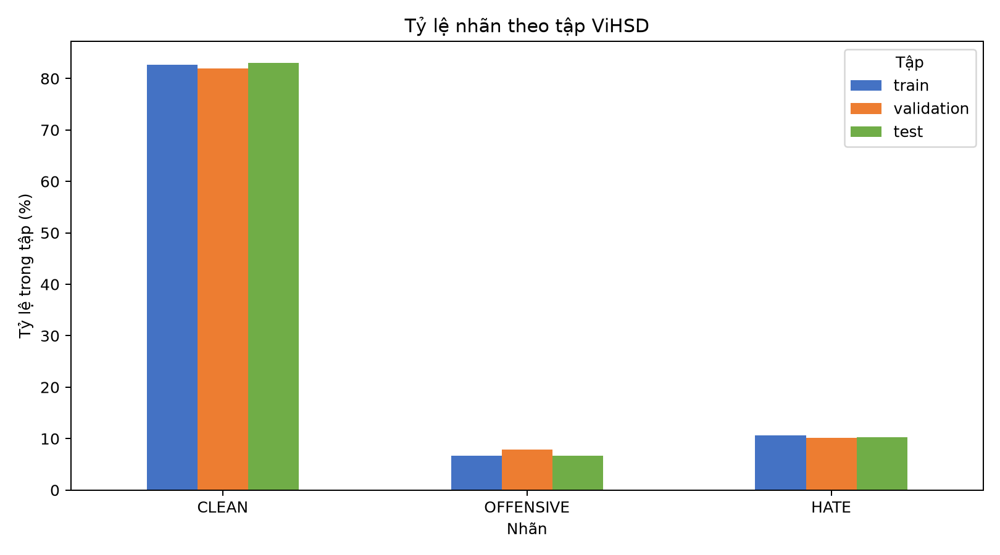
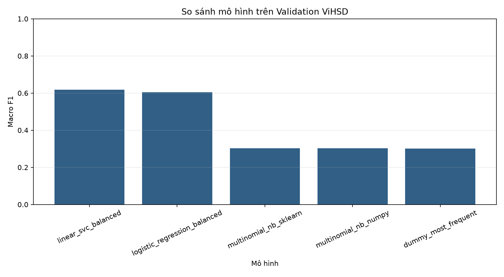
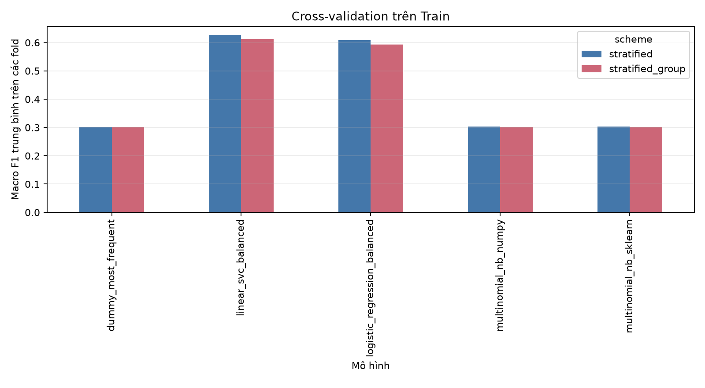

# ViHSD Project — Phát hiện ngôn từ thù ghét và xúc phạm tiếng Việt

> **Đề tài học phần Học máy · Nhóm 15 · CNTT K22H · ICTU**  
> **Giảng viên hướng dẫn:** Nguyễn Tuấn Anh  
> **Phạm vi:** nghiên cứu, tiền xử lý, huấn luyện và đánh giá mô hình phân loại bình luận mạng xã hội tiếng Việt.

[**Báo cáo Tuần 4**](reports/exam1_report.md) · [**Báo cáo Tuần 6**](reports/exam2_report.md) · [**Notebook Tuần 4**](notebooks/exam1_practice.ipynb) · [**Notebook Tuần 6**](notebooks/exam2_practice.ipynb) · [**Nhật ký tiến độ**](docs/PROGRESS.md)

## 1. Giới thiệu dự án

Dự án nghiên cứu bài toán **phân loại văn bản có giám sát, gồm ba lớp** trên bộ dữ liệu ViHSD của UIT. Mỗi mẫu là một bình luận mạng xã hội bằng tiếng Việt:

| Nhãn | Mã | Ý nghĩa trong ViHSD |
|---|---:|---|
| **CLEAN** | `0` | Nội dung không được gán là xúc phạm hoặc thù ghét |
| **OFFENSIVE** | `1` | Nội dung mang tính xúc phạm |
| **HATE** | `2` | Nội dung mang tính thù ghét |

**Đầu vào:** trường văn bản `free_text`. **Đầu ra:** `label_id` thuộc `{0, 1, 2}`. Nhãn được giữ theo bộ dữ liệu gốc; cách hiểu từng nhãn phụ thuộc quy tắc gán nhãn và ngữ cảnh.

Mục tiêu của dự án:

1. Khảo sát dữ liệu tiếng Việt trên mạng xã hội, nhận diện mất cân bằng lớp, văn bản trùng và các vấn đề chất lượng.
2. Xây dựng quy trình chuẩn hóa, tách từ và biểu diễn văn bản thành đặc trưng TF-IDF.
3. Cài đặt, huấn luyện và so sánh các thuật toán phân loại cơ bản.
4. Đánh giá trung thực bằng **Macro F1**, Precision, Recall, F1 từng lớp và ma trận nhầm lẫn; hạn chế rò rỉ dữ liệu.
5. Tạo mã nguồn, Notebook và tài liệu có thể tái lập trong môi trường được cấp quyền truy cập ViHSD.

> **Lưu ý:** Đây là dự án học tập/nghiên cứu, chưa phải hệ thống kiểm duyệt nội dung sẵn sàng triển khai trong môi trường thực tế.

## 2. Tiến độ học phần

| Giai đoạn | Nội dung | Tình trạng |
|---|---|---|
| **Bài kiểm tra 1 — Tuần 4** | Xác định bài toán; EDA; đánh giá chất lượng; chuẩn hóa; TF-IDF | Đã có mã nguồn và báo cáo kỹ thuật |
| **Bài kiểm tra 2 — Tuần 6** | Baseline; các mô hình NB/LR/SVM; CV; Validation; Test; phân tích lỗi | Đã có lượt thực nghiệm đầu và kết quả tổng hợp |
| **Giai đoạn tiếp theo** | Phân tích sâu hơn, thử đặc trưng và điều chỉnh siêu tham số có kiểm soát | Chưa công bố kết quả cuối |

Các bài thực hành Tuần 6 của **Hoàng Ngọc Tú** và **Lê Quang Tài** được ghi nhận là **sinh viên tự báo cáo**; kết quả Train/Validation đã được đối chiếu kỹ thuật. Việc vấn đáp và chấm điểm cá nhân thuộc giảng viên, không suy ra từ việc Codex chạy mã hoặc từ commit.

## 3. Bộ dữ liệu ViHSD

Nguồn: [UIT NLP — ViHSD trên Hugging Face](https://huggingface.co/datasets/uitnlp/vihsd) · [Bài báo giới thiệu ViHSD](https://arxiv.org/abs/2103.11528)

- Dataset ID: `uitnlp/vihsd`.
- Revision đã sử dụng: `88e81b36ca376867640dad9df295e0f7d499ab80`.
- Schema: `free_text: string`, `label_id: int64`.
- Tổng cộng **33.400** bình luận.

| Tập dữ liệu chính thức | Số mẫu | Mục đích |
|---|---:|---|
| Train | 24.048 | Fit mô hình và thực hiện cross-validation |
| Validation | 2.672 | So sánh, chọn mô hình/cấu hình |
| Test | 6.680 | Đánh giá cuối sau khi khóa lựa chọn |

**Phân bố Train:** CLEAN 19.886 (82,69%), OFFENSIVE 1.606 (6,68%), HATE 2.556 (10,63%). Dữ liệu mất cân bằng rõ rệt nên Accuracy không đủ để đánh giá riêng hai lớp ít mẫu.



### Lưu ý về quyền sử dụng

ViHSD yêu cầu đăng nhập/chấp thuận điều kiện truy cập. Metadata của Hugging Face và ghi chú sử dụng cho nghiên cứu của tác giả cần được đối chiếu cẩn trọng; dự án **không tái phân phối dữ liệu gốc, bình luận thật, token hoặc bảng kết quả có thể khôi phục nội dung**. Xem [hướng dẫn truy cập và điều kiện sử dụng](docs/data_access.md).

## 4. Phương pháp và thiết kế thực nghiệm

### Tiền xử lý và đặc trưng

- Chuẩn Unicode NFC, xử lý khoảng trắng và một số từ viết tắt/teencode theo quy tắc hữu hạn; không sửa nhãn hoặc ghi đè nguồn.
- Tách từ tiếng Việt bằng **PyVi**.
- **TF-IDF từ**: word n-gram `(1, 2)`.
- **TF-IDF ký tự**: character n-gram `(2, 5)` (đã chuẩn bị từ Tuần 4; chế độ `combined` được hỗ trợ trong Development).
- Dùng ma trận thưa `scipy.sparse`, không chuyển toàn bộ ma trận nhiều chiều thành dense.

Tuần 4 đã tạo được **166.981** đặc trưng từ và **393.272** đặc trưng ký tự (tổng **560.253**). **Lượt kết quả Test được công bố ở Tuần 6 chỉ dùng word TF-IDF 166.981 chiều**, không được diễn giải là điểm của cấu hình kết hợp.

### Các thuật toán

| Mô hình | Vai trò |
|---|---|
| `DummyClassifier` — most frequent | Baseline thực nghiệm, luôn dự đoán lớp phổ biến nhất |
| Multinomial Naive Bayes tự cài bằng NumPy | Học và kiểm thử công thức Bayes, Laplace smoothing; hỗ trợ sparse |
| `MultinomialNB` (scikit-learn) | Đối chiếu với bản NumPy |
| `LogisticRegression` với `class_weight="balanced"` | Mô hình tuyến tính so sánh |
| `LinearSVC` với `class_weight="balanced"` | Mô hình tuyến tính được chọn theo Validation ở lượt đầu |

### Quy trình đánh giá

1. **Train:** fit các phép biến đổi và classifier; thực hiện 3-fold `StratifiedKFold` và `StratifiedGroupKFold`.
2. **Trong từng fold:** TF-IDF được fit mới từ phần huấn luyện của fold; phần giữ lại chỉ được transform.
3. **Validation:** so sánh mô hình theo Macro F1 và khóa cấu hình lựa chọn.
4. **Test:** chỉ đánh giá cấu hình đã khóa; không dùng điểm Test để chọn tham số hoặc đặc trưng.

Lượt thực nghiệm Tuần 6 đã phân biệt hai chế độ CLI:

- **`development` (mặc định):** chỉ nạp Train/Validation, không đọc hoặc đánh giá Test. Dùng cho thực hành và so sánh cấu hình.
- **`final-test`:** cần cấu hình đã khóa từ Validation, được gọi tường minh, lưu vào thư mục riêng và không tự lựa chọn lại mô hình. Không dùng khi thử tham số.

## 5. Kết quả thực nghiệm đã công bố

### So sánh trên Validation — word TF-IDF

| Mô hình | Macro F1 Validation |
|---|---:|
| Dummy majority | 0,3003 |
| MultinomialNB NumPy (`alpha=1.0`) | 0,3029 |
| MultinomialNB scikit-learn (`alpha=1.0`) | 0,3029 |
| Logistic Regression balanced (`C=1`) | 0,6049 |
| **Linear SVC balanced (`C=1`)** | **0,6184** |



**Linear SVC** được chọn theo Validation Macro F1, trước khi tính điểm Test.

### Kiểm định chéo trên Train (Linear SVC, 3 fold)

| Phương pháp CV | Macro F1 trung bình ± độ lệch chuẩn |
|---|---:|
| StratifiedKFold | **0,6262 ± 0,0049** |
| StratifiedGroupKFold | **0,6117 ± 0,0078** |



Phép kiểm tra trên Train ghi nhận 22.500 nhóm khóa văn bản chuẩn hóa; trong `StratifiedKFold` có văn bản trùng xuất hiện ở hai phía của một fold, trong khi grouped CV giữ các khóa trùng trong cùng một nhóm. Vì vậy phải diễn giải kết quả CV cùng rủi ro trùng lặp, không chỉ chọn số lớn hơn.

### Đánh giá Test của mô hình đã khóa

| Chỉ số | Giá trị |
|---|---:|
| **Test Macro F1** | **0,6017** |
| **Test Accuracy** | **0,8618 (86,18%)** |
| F1 CLEAN | 0,9311 |
| F1 OFFENSIVE | 0,3097 |
| F1 HATE | 0,5644 |

Trong 444 bình luận OFFENSIVE của Test, mô hình nhận diện đúng 105; **Recall OFFENSIVE ≈ 23,65%**. Accuracy cao không đồng nghĩa hệ thống hoạt động tốt trên cả ba lớp.

Test chính thức có **6.680** mẫu. Một phép phân tích độ nhạy đã định nghĩa trước, loại 814 dòng Test có khóa văn bản trùng Train, còn 5.866 mẫu và có Macro F1 **0,5926**; phép này không thay thế điểm Test chính thức.

> Các điểm trên là **kết quả của lượt baseline ban đầu**, không phải kết quả tối ưu hóa. Không dùng những điểm Test đã công bố để thử/chọn mô hình mới.

Xem chi tiết ở [báo cáo Tuần 6](reports/exam2_report.md) và [kết quả tổng hợp](reports/exam2_results/).

## 6. Cấu trúc repository

```text
ViHSD_Project/
├── src/vihsd/                 # Data, EDA, preprocessing, vectorization, models, CV
├── scripts/
│   ├── run_real_dataset_analysis.py
│   ├── run_exam2_experiments.py
│   ├── run_eda.py
│   └── audit_quality.py
├── notebooks/
│   ├── exam1_practice.ipynb
│   └── exam2_practice.ipynb
├── tests/                     # Unit tests và kiểm thử tích hợp
├── docs/                      # Kế hoạch, hướng dẫn, phân công, nhật ký
├── reports/
│   ├── exam1_report.md
│   ├── exam2_report.md
│   ├── figures/
│   └── exam2_results/
├── requirements.txt
├── requirements-data.txt
├── requirements-dev.txt
├── pyproject.toml
├── AGENTS.md
└── README.md
```

Dữ liệu được cấp quyền trong `data/raw/` và dữ liệu dẫn xuất cục bộ trong `artifacts/` không nằm trong Git.

## 7. Cài đặt và chạy trên Windows

Yêu cầu: **Python 3.10 trở lên**, Git, quyền truy cập ViHSD qua Hugging Face. Các lệnh dưới đây dùng PowerShell từ thư mục dự án.

### Bước 1 — Clone repository và tạo môi trường

```powershell
git clone https://github.com/ngoctuls2005-dev/ViHSD_Project.git
cd ViHSD_Project
py -3 -m venv .venv
.\.venv\Scripts\python.exe -m pip install --upgrade pip
.\.venv\Scripts\python.exe -m pip install -e .
.\.venv\Scripts\python.exe -m pip install -r requirements-dev.txt
```

`requirements-dev.txt` kéo theo dependencies dữ liệu và `pytest`.

### Bước 2 — Truy cập dữ liệu hợp lệ

Đọc [hướng dẫn ViHSD](docs/data_access.md), được cấp quyền tại [trang dữ liệu](https://huggingface.co/datasets/uitnlp/vihsd), rồi xác thực bằng `hf auth login`. Không đưa Hugging Face token vào mã nguồn hoặc commit.

### Bước 3 — Thực hiện phân tích Tuần 4

```powershell
.\.venv\Scripts\python.exe scripts/run_real_dataset_analysis.py
```

Script xác minh schema/split, tạo bảng EDA và biểu đồ; dữ liệu gốc lưu cục bộ trong `data/raw/`. Notebook liên quan: [exam1_practice.ipynb](notebooks/exam1_practice.ipynb).

### Bước 4 — Chạy thực nghiệm Development Tuần 6

```powershell
.\.venv\Scripts\python.exe scripts/run_exam2_experiments.py --mode development --features word --cv-folds 3
```

Đây là chế độ phù hợp cho học tập và chạy thử: **không đọc/chấm Test**. Mỗi lần chạy tạo thư mục kết quả riêng trong `reports/exam2_results/development/word/<run-id>/`.

Để thử đặc trưng kết hợp **chỉ trên Train/Validation**:

```powershell
.\.venv\Scripts\python.exe scripts/run_exam2_experiments.py --mode development --features combined --cv-folds 3
```

Không sử dụng `--mode final-test` khi luyện thực hành hoặc lựa chọn cấu hình.

### Bước 5 — Chạy kiểm thử

```powershell
.\.venv\Scripts\python.exe -m pytest -q tests
```

Kiểm thử tích hợp cần dữ liệu thật có quyền truy cập:

```powershell
$env:VIHSD_RUN_INTEGRATION = "1"
$env:MPLBACKEND = "Agg"
.\.venv\Scripts\python.exe -m pytest -q tests
Remove-Item Env:VIHSD_RUN_INTEGRATION
```

Theo lần kiểm thử đã ghi trong nhật ký 10/11/2026: **42 passed, 5 subtests passed** trên môi trường có dữ liệu thật. Đây là số liệu từ lần chạy đã ghi nhận, không phải đảm bảo mọi máy đều cho kết quả giống hệt.

## 8. Hướng dẫn cho thành viên và báo cáo

| Tài liệu | Công dụng |
|---|---|
| [Báo cáo Bài kiểm tra 1 — Tuần 4](reports/exam1_report.md) | Bài toán, nguồn dữ liệu, EDA, chất lượng và TF-IDF |
| [Báo cáo Bài kiểm tra 2 — Tuần 6](reports/exam2_report.md) | Các mô hình, CV, Validation/Test, phân tích lỗi |
| [Kế hoạch Tuần 6](docs/exam2_plan.md) | Phạm vi, từng bước và điều kiện nghiệm thu |
| [Nghiên cứu liên quan](docs/exam2_research.md) | Lý do chọn mô hình, các bài báo học thuật |
| [Hướng dẫn Hoàng Ngọc Tú](docs/EXAM2_START_HERE_TU.md) | NB NumPy, thay alpha, đọc F1/confusion matrix |
| [Hướng dẫn Lê Quang Tài](docs/EXAM2_START_HERE_TAI.md) | Pipeline, grouped CV, thay C/class_weight |
| [Bài vấn đáp Tuần 6](docs/exam2_viva_questions.md) | Câu hỏi lý thuyết và thao tác 10–15 phút |
| [Nhật ký đóng góp](docs/contributions.md) | Tách việc tự báo cáo khỏi kiểm chứng kỹ thuật |
| [Nhật ký tiến độ](docs/PROGRESS.md) | Những bước đã chạy, giới hạn và kiểm thử |

## 9. Giới hạn của nghiên cứu

- Dữ liệu mất cân bằng, đặc biệt ít mẫu OFFENSIVE; mô hình còn bỏ sót nhiều bình luận lớp này.
- Kiểm toán Tuần 4 phát hiện **792/797 chuỗi duy nhất trùng Train–Test trước/sau chuẩn hóa**, trong đó có **80 chuỗi giao xung đột nhãn**. Đây là nguy cơ đánh giá lạc quan, cần báo cáo minh bạch.
- Quy tắc tiền xử lý chỉ xử lý một phần viết tắt, không giải quyết triệt để ngôn ngữ mỉa mai, teencode và ngữ cảnh.
- Các mô hình hiện dùng đặc trưng TF-IDF và không chứng minh được khả năng hoạt động trên dữ liệu ngoài miền ViHSD.
- Tuần 6 mới là lượt so sánh ban đầu; chưa có tối ưu sâu hoặc kết quả Test của cấu hình combined.

## 10. Nghiên cứu và nguồn tham khảo

1. Son T. Luu, Kiet Van Nguyen, Ngan Luu-Thuy Nguyen (2021). [*A Large-scale Dataset for Hate Speech Detection on Vietnamese Social Media Texts*](https://arxiv.org/abs/2103.11528).
2. UIT NLP. [ViHSD Dataset Card](https://huggingface.co/datasets/uitnlp/vihsd).
3. Dat Quoc Nguyen, Anh Tuan Nguyen (2020). [*PhoBERT: Pre-trained language models for Vietnamese*](https://aclanthology.org/2020.findings-emnlp.92/).
4. Nguyen et al. (2023). [*ViSoBERT: A Pre-Trained Language Model for Vietnamese Social Media Text Processing*](https://aclanthology.org/2023.emnlp-main.315/).
5. Scikit-learn. [Tài liệu Naive Bayes, Linear Models và Cross-validation](https://scikit-learn.org/stable/user_guide.html).
6. Nguyễn Tuấn Anh. [Kho tài liệu và mẫu báo cáo học phần Học máy](https://github.com/ntanh80/machine-learning).

Các công trình bên ngoài được dùng để tham khảo lý thuyết và phương pháp; **điểm mô hình trong repository là kết quả thực nghiệm của dự án**, không lấy từ báo cáo khác.

## 11. Ghi nhận hỗ trợ AI và tính trung thực

Nhóm có sử dụng ChatGPT/Codex GPT-6 Luna để hỗ trợ thiết kế quy trình, viết mã, kiểm thử, thực nghiệm và biên soạn tài liệu. Các hoạt động của công cụ không tự chứng minh sinh viên đã trực tiếp thực hiện hoặc hiểu kết quả. Nhật ký ghi rõ việc sinh viên tự báo cáo và phần đối chiếu kỹ thuật; **giảng viên đánh giá phần vấn đáp/thực hành cá nhân**.

Không sử dụng dự án để tự động gán nhãn hoặc xử lý bình luận của người thật trong các tình huống ảnh hưởng đến quyền lợi cá nhân khi chưa có kiểm định và giám sát phù hợp.

---

**Repository:** https://github.com/ngoctuls2005-dev/ViHSD_Project  
**Nhóm 15 — Học máy — ICTU**
