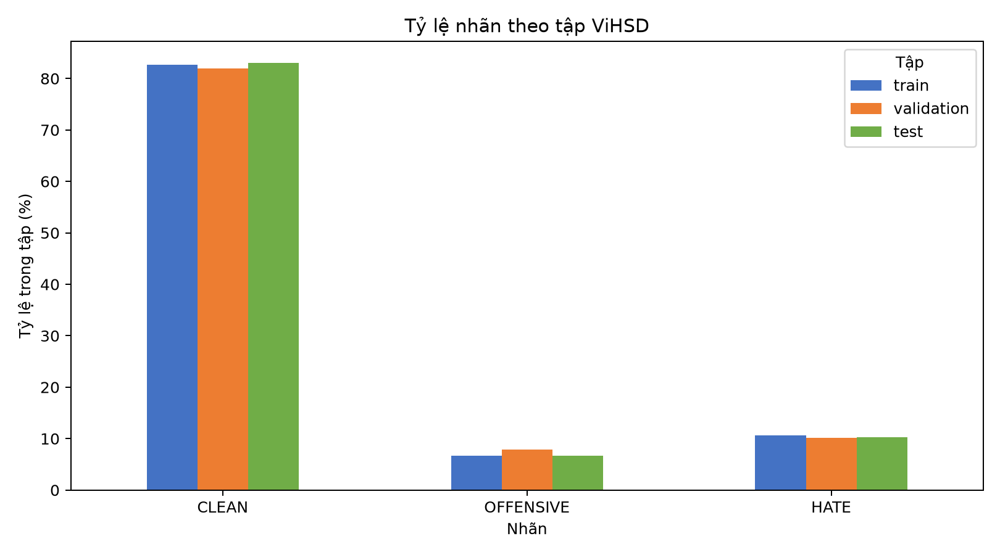
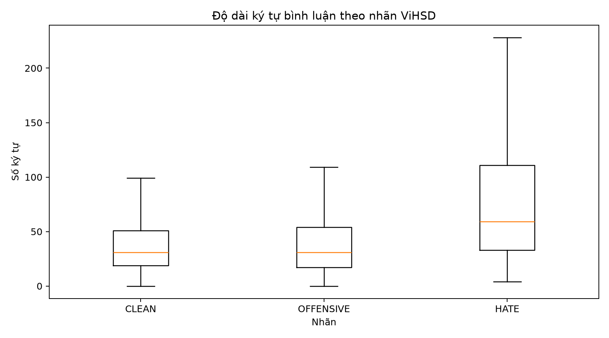

# Báo cáo Bài kiểm tra 1 – ViHSD

> **Trạng thái:** bản báo cáo dựa trên dữ liệu thật, revision `88e81b36ca376867640dad9df295e0f7d499ab80`. Dữ liệu gốc và bình luận thật chỉ được giữ cục bộ; báo cáo công khai chỉ chứa thống kê tổng hợp. Chưa huấn luyện mô hình.

## 1. Phát biểu bài toán

Đây là bài toán phân loại văn bản đa lớp có giám sát. Một mẫu là bình luận mạng xã hội tiếng Việt (`free_text`); đầu ra là một trong ba mã nhãn gốc (`label_id`): `0 = CLEAN`, `1 = OFFENSIVE`, `2 = HATE`. Mã nhãn được giữ nguyên. Đặc trưng dùng cho bước chuẩn bị là TF-IDF n-gram từ và ký tự; TF-IDF từ dùng PyVi để tách từ tiếng Việt.

## 2. Mục tiêu và tiêu chí thành công

Mục tiêu học máy là dự đoán ba nhãn ViHSD từ bình luận. F1 Macro được chọn làm chỉ số chính vì tính F1 đều cho từng lớp, phù hợp hơn Accuracy đơn lẻ khi lớp nhỏ chỉ chiếm một phần nhỏ dữ liệu. Khi bắt đầu giai đoạn mô hình, cần báo cáo Precision, Recall, F1 từng lớp, ma trận nhầm lẫn và so sánh với baseline. Bài kiểm tra 1 chưa yêu cầu huấn luyện; hiện chưa có kết quả mô hình hay ngưỡng hiệu năng tự đặt.

## 3. Nguồn, điều kiện sử dụng và từ điển dữ liệu

Nguồn là [ViHSD chính thức trên Hugging Face](https://huggingface.co/datasets/uitnlp/vihsd), do nhóm UIT NLP cung cấp. Tác giả mô tả 33.400 bình luận có nhãn `CLEAN`, `OFFENSIVE`, `HATE` và yêu cầu trích dẫn bài báo Luu, Nguyen và Nguyen (2021), [arXiv:2103.11528](https://arxiv.org/abs/2103.11528). Hugging Face yêu cầu người dùng đã đăng nhập chấp thuận điều kiện truy cập. Thẻ hiện ghi metadata MIT, còn README tác giả nói dữ liệu chỉ dùng cho nghiên cứu; phạm vi hai ghi chú này chưa được làm rõ. Vì vậy, nhóm không công khai dữ liệu hoặc bình luận nguyên văn.

| Trường | Kiểu đã xác minh | Ý nghĩa | Vai trò |
|---|---|---|---|
| `free_text` | `string` | Nội dung bình luận gốc | Đầu vào |
| `label_id` | `int64` | `0=CLEAN`, `1=OFFENSIVE`, `2=HATE` | Nhãn mục tiêu |

Schema số nguyên không khai báo metadata `ClassLabel`; ánh xạ trên được đối chiếu với thứ tự tên lớp trong tài liệu tác giả và các ví dụ xem trước của dữ liệu. Các split và số dòng đọc trực tiếp:

| Tập | Số bình luận | Kiểu văn bản | Kiểu nhãn |
|---|---:|---|---|
| Train | 24.048 | string | int64 |
| Validation | 2.672 | string | int64 |
| Test | 6.680 | string | int64 |
| **Tổng** | **33.400** |  |  |

Dữ liệu được tải bằng `load_dataset("uitnlp/vihsd")`, revision được ghi lại và bản gốc lưu tại `data/raw/uitnlp_vihsd/`, thư mục bị Git bỏ qua. Xem [hướng dẫn tái tạo và điều kiện truy cập](../docs/data_access.md). Không ghi token vào dự án.

## 4. Khảo sát thống kê và phân bố

### Phân bố nhãn theo split

| Tập | CLEAN | OFFENSIVE | HATE |
|---|---:|---:|---:|
| Train | 19.886 (82,69%) | 1.606 (6,68%) | 2.556 (10,63%) |
| Validation | 2.190 (81,96%) | 212 (7,93%) | 270 (10,10%) |
| Test | 5.548 (83,05%) | 444 (6,65%) | 688 (10,30%) |

**Nhận xét:** Cả ba split giữ phân bố gần nhau. CLEAN là lớp đa số; OFFENSIVE là lớp ít nhất. Trong Train, tỷ lệ lớp đông/lớp ít là `19.886 / 1.606 = 12,38`, nên đánh giá sau này cần nêu kết quả từng lớp và dùng F1 Macro làm chỉ số chính.

### Độ dài bình luận

| Nhãn | Số mẫu | Ký tự trung bình | Ký tự trung vị | Khoảng ký tự | Đơn vị cách trắng trung bình |
|---|---:|---:|---:|---:|---:|
| CLEAN | 27.624 | 44,83 | 31 | 0–20.816 | 10,48 |
| OFFENSIVE | 2.262 | 44,11 | 31 | 0–394 | 10,73 |
| HATE | 3.514 | 84,17 | 59 | 4–714 | 20,07 |

**Nhận xét:** Bình luận HATE dài hơn trong phân bố này: trung vị 59 ký tự, so với 31 ở hai nhãn còn lại; số đơn vị tách bởi khoảng trắng trung bình cũng gần gấp đôi. Biểu đồ ẩn điểm ngoại lệ để nhìn rõ phần giữa của phân bố; các ngoại lệ độ dài vẫn được thống kê riêng ở mục 6. `whitespace_token_count` là số đơn vị phân cách bằng khoảng trắng, không phải số từ tiếng Việt đã tách bằng PyVi.

## 5. Quan hệ đặc trưng văn bản với nhãn

Các quan hệ dưới đây đo được trên Train để tránh dùng Test khi xem xét đặc trưng. Phân tích n-gram dùng 20 unigram/bigram có mức xuất hiện tương đối thiên về từng lớp nhất, với hỗ trợ tối thiểu 20 bình luận. Báo cáo chỉ ghi độ phủ tổng hợp, không công khai các chuỗi trích từ bình luận.

| Tín hiệu trên Train | CLEAN | OFFENSIVE | HATE |
|---|---:|---:|---:|
| Có dấu hiệu phủ định (`không` và một số dạng viết thường gặp) | 9,40% | 7,97% | 16,90% |
| Trung vị số ký tự | 31 | 31 | 59 |
| Độ phủ của 20 n-gram thiên về lớp | 4,67% trong CLEAN | 42,65% trong OFFENSIVE; 12,36% ở lớp khác | 26,84% trong HATE; 1,46% ở lớp khác |

**Nhận xét có số liệu:**

1. Dấu hiệu phủ định xuất hiện ở 16,90% bình luận HATE trong Train, so với 9,40% CLEAN và 7,97% OFFENSIVE. Tín hiệu này có thể phản ánh lập luận/phản đối trong văn bản; bản thân từ phủ định không xác định nhãn.
2. Nhóm n-gram thiên về OFFENSIVE phủ 42,65% bình luận OFFENSIVE nhưng cũng xuất hiện ở 12,36% hai lớp còn lại. Nhóm thiên về HATE phủ 26,84% HATE và 1,46% lớp khác. Đây là dấu hiệu hữu ích cho biểu diễn từ, nhưng độ phủ không đồng nghĩa với độ chính xác phân loại và cần được kiểm tra trên Validation khi xây dựng mô hình.
3. HATE dài hơn rõ rệt: trung vị 59 so với 31 ký tự và trung bình 84,17 so với 44,83 CLEAN / 44,11 OFFENSIVE. N-gram ký tự có thể giữ được biến thể chính tả, còn n-gram từ biểu diễn cụm tiếng Việt; cần so sánh bằng đánh giá hợp lệ ở giai đoạn sau.

## 6. Vấn đề chất lượng dữ liệu

Văn bản trùng được chuẩn hóa chỉ để dò: Unicode NFC, gộp khoảng trắng, bỏ khoảng trắng đầu/cuối và không phân biệt hoa thường. `duplicate_text_excess_rows` là số dòng lặp dư trong cùng split; `conflicting_duplicate_rows` là tổng số dòng nằm trong nhóm văn bản trùng nhưng có nhãn khác nhau, không phải số nhóm.

| Vấn đề | Train | Validation | Test |
|---|---:|---:|---:|
| Thiếu văn bản | 2 (0,008%) | 0 | 0 |
| Chuỗi rỗng/ chỉ có khoảng trắng (không tính giá trị thiếu) | 0 | 0 | 0 |
| Nhãn thiếu / ngoài tập `{0,1,2}` | 0 / 0 | 0 / 0 | 0 / 0 |
| Giá trị văn bản không phải chuỗi | 0 | 0 | 0 |
| Có ký tự điều khiển | 0 | 0 | 0 |
| Dòng trùng dư trong split | 1.535 (6,38%) | 22 (0,82%) | 107 (1,60%) |
| Dòng thuộc nhóm trùng khác nhãn | 292 (1,21%) | 2 (0,07%) | 12 (0,18%) |
| Có chuỗi ký tự lặp từ 3 ký tự trở lên | 3.731 (15,52%) | 423 (15,83%) | 997 (14,93%) |
| Có ít nhất một mục trong bộ dò viết tắt/teencode | 2.180 (9,06%) | 237 (8,87%) | 585 (8,76%) |
| Ngoại lệ độ dài theo quy tắc 1,5×IQR | 1.837 (7,64%) | 217 (8,12%) | 543 (8,13%) |

Số chuỗi bình luận duy nhất giao nhau giữa các split, sau quy tắc chuẩn hóa dò trùng:

| Cặp split | Trước tiền xử lý | Sau tiền xử lý |
|---|---:|---:|
| Train–Validation | 322 | 324 |
| Train–Test | 792 | 797 |
| Validation–Test | 92 | 93 |

Đây là rủi ro rò rỉ do dữ liệu trùng, đặc biệt ở cặp Train–Test. Không loại dòng hay chia lại dữ liệu trong bài này; phải giữ lại cảnh báo khi đánh giá mô hình. Cách chuẩn hóa từ viết tắt làm một số chuỗi khác nhau trở nên giống nhau, nên số giao nhau tăng nhẹ sau xử lý.

## 7. Xử lý chất lượng dữ liệu

Quy tắc chỉ tạo văn bản dẫn xuất trong bộ nhớ; không sửa `data/raw/`, không sửa nhãn và không xóa dòng.

| Phương pháp | Lý do và giới hạn |
|---|---|
| Chuẩn hóa Unicode NFC | Gom các cách mã hóa Unicode tương đương; không đổi ý nghĩa từ theo chủ đích. |
| Gộp khoảng trắng, bỏ khoảng trắng thừa ở hai đầu | Giảm khác biệt định dạng khi dò trùng và tạo đặc trưng. |
| Mở rộng danh sách viết tắt có kiểm soát (`ko`, `khum`, `dc`, `mik`, `mn`, `vs` và một số dạng tương tự) | Chuẩn hóa một số cách gõ phổ biến; chỉ thay token độc lập và không tự suy diễn dạng chưa biết. |
| Giữ phủ định, dấu câu, emoji, ký tự lặp và nhãn | Các dấu hiệu này có thể mang sắc thái hoặc cường độ; loại bỏ tùy tiện có thể làm mất tín hiệu. |
| Không tự xóa trùng hoặc ngoại lệ độ dài | Cần kiểm tra xung đột nhãn và nội dung trước khi quyết định; hiện chỉ thống kê để giữ tính truy vết. |
| Biểu diễn giá trị thiếu thành chuỗi rỗng khi tạo ma trận | Giữ nguyên số dòng và nhãn cho adapter vectorizer; hai giá trị thiếu vẫn được ghi nhận, không giả định đó là bình luận hợp lệ. |

| Tập | Số dòng văn bản thay đổi | Tỷ lệ trong văn bản không thiếu | Tổng ký tự trước → sau |
|---|---:|---:|---:|
| Train | 2.921 | 12,15% | 1.185.168 → 1.186.368 |
| Validation | 336 | 12,57% | 128.000 → 128.121 |
| Test | 789 | 11,81% | 320.732 → 321.086 |

Trong bản dẫn xuất, các dạng nằm trong bộ dò viết tắt giảm từ 9% xuống 0%; đây là kết quả của từ điển hữu hạn, không phải bằng chứng rằng mọi teencode đã được xử lý. Hai dòng thiếu ở Train được biểu diễn thành hai chuỗi rỗng trong bản dẫn xuất, vẫn giữ chỉ số dòng và nhãn gốc.

## 8. Chuẩn bị dữ liệu và đặc trưng

Giữ ba split chính thức. Văn bản dẫn xuất được chuẩn hóa rồi tách từ bằng PyVi cho TF-IDF từ, n-gram từ `(1,2)`; TF-IDF ký tự dùng n-gram `(2,5)`. Hai vectorizer chỉ `fit` trên Train. Validation và Test chỉ `transform`; cùng một số chiều được dùng ở cả ba tập.

| Tập | Mẫu | Đặc trưng từ | Đặc trưng ký tự | Tổng chiều | TF-IDF fit/transform |
|---|---:|---:|---:|---:|---|
| Train | 24.048 | 166.981 | 393.272 | 560.253 | `fit_transform` |
| Validation | 2.672 | 166.981 | 393.272 | 560.253 | `transform` |
| Test | 6.680 | 166.981 | 393.272 | 560.253 | `transform` |

Kiểm tra đã chạy đến ma trận sparse và xác nhận số hàng khớp từng split, số chiều giữ nguyên, vectorizer được khớp từ Train. Không huấn luyện thuật toán phân loại và không chọn tham số từ Test. Rủi ro trùng giữa split ở mục 6 vẫn tồn tại trong dữ liệu nguồn; vì thế không được diễn giải kết quả đánh giá tương lai như độc lập tuyệt đối nếu chưa xử lý hoặc phân tích ảnh hưởng của các cặp trùng.

## 9. Phương pháp và chỉ số đánh giá

F1 Macro là chỉ số chính vì ba lớp có tỷ lệ rất khác nhau. Cần báo cáo Precision, Recall, F1 cho từng lớp để thấy riêng khả năng phát hiện OFFENSIVE và HATE, cùng ma trận nhầm lẫn để phân tích hai lớp dễ bị nhầm. Giữ Validation cho lựa chọn phát triển; Test chỉ dành cho đánh giá cuối. Split chính thức có văn bản trùng nên cần nêu rõ rủi ro đó trước khi đưa ra kết luận mô hình.

## Tiến độ đối chiếu 10 tiêu chí

| Tiêu chí | Trạng thái bằng chứng |
|---|---|
| 1–2 | Mục tiêu, đầu vào/đầu ra và F1 Macro đã nêu; chưa có mô hình theo đúng phạm vi Bài kiểm tra 1. |
| 3–4 | Đã xác minh nguồn, schema, số dòng, nhãn, phân bố và biểu đồ trên dữ liệu thật. |
| 5 | Đã phân tích độ dài, tín hiệu phủ định và độ phủ n-gram trên Train với số liệu. |
| 6 | Đã định lượng thiếu, trùng, xung đột nhãn, ngoại lệ, kiểu dữ liệu, lệch lớp và trùng giữa split. |
| 7 | Đã chạy chuẩn hóa trên bản dẫn xuất, so sánh trước/sau và giải thích từng quyết định; dữ liệu/nhãn gốc không đổi. |
| 8 | Đã chạy PyVi và TF-IDF từ/ký tự trên ba split; fit chỉ trên Train. Đã ghi nhận rủi ro trùng split. |
| 9 | Hướng dẫn giải thích chiến lược hold-out/F1 Macro có trong `docs/evaluation_guide.md`; sinh viên vẫn cần tự giải thích. |
| 10 | Notebook thực hành và câu hỏi dựa trên số liệu thật được chuẩn bị; sinh viên vẫn cần chạy lại và thao tác cá nhân. |

Điểm do giảng viên đánh giá. Bằng chứng kiểm thử và các giới hạn còn lại được ghi trong [`docs/PROGRESS.md`](../docs/PROGRESS.md).

## Hạn chế, đóng góp và phạm vi dùng AI

- Phân bố lớp mất cân bằng mạnh; hai nhãn ít mẫu cần được đánh giá riêng.
- Có văn bản trùng trong cùng split và giữa các split; 792 chuỗi duy nhất trùng Train–Test theo quy tắc dò đã nêu.
- Có hai giá trị văn bản thiếu trong Train; ngoại lệ độ dài và cách viết bất thường được thống kê nhưng chưa loại bỏ.
- Metadata giấy phép MIT và ghi chú “chỉ dùng cho nghiên cứu” của tác giả chưa được đối chiếu pháp lý; dữ liệu được giữ riêng, báo cáo công khai không chứa bình luận nguyên văn.
- AI hỗ trợ soạn mã, cấu trúc báo cáo và nội dung ôn tập. Nhóm cần kiểm tra lại kết quả, hiểu từng bước và tự thực hành trước khi nộp.
